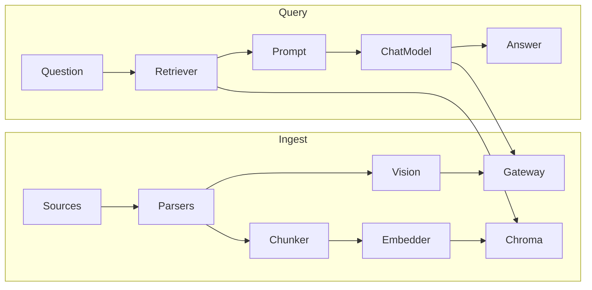
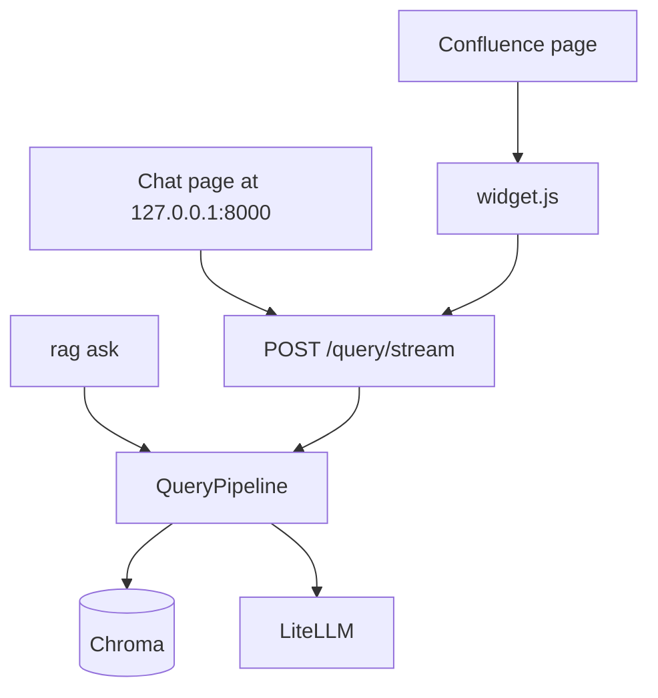

# Architecture

This project answers questions from department Confluence pages and local files. It does that in two separate runs: **ingest** builds a local search index, and **query** searches that index and asks a chat model to answer from the passages it found.

## The two paths

Ingest is slow because parsing, OCR, and image captions run on the laptop, and captions also call the company gateway. Query is a search on the laptop plus one chat call to the gateway.

## How a run starts

`python -m rag` loads `rag/api/cli.py`. Every command builds one `Components` object from `config.yaml` and `.env`.

`Components` (`rag/pipeline/components.py`) is the wiring. Each part is created on first use and then reused:

| Piece | Created from | Used by |
|---|---|---|
| Embedder | `embedding` in config | ingest and query |
| Chroma store | `data/chroma` | ingest writes, query reads |
| State database | `data/state.sqlite` | ingest versions, caption cache |
| Chat model | `llm.provider` | query |
| Vision model | `vision`, falling back to the chat gateway settings | ingest captions |
| Parsers | `parsing.backend` plus the vision describer | ingest |
| Chunker | `chunking` plus the embedder's token counter | ingest |
| Retriever | embedder, Chroma, BM25 | query |
| Prompt builder | `rag/prompt/templates/` | query |

`config.yaml` holds settings. `.env` holds secrets (`LLM_API_KEY`, `SSL_CERT_FILE`, `CONFLUENCE_URL`, `CONFLUENCE_TOKEN`). An environment variable `RAG_LLM__OPENAI_COMPAT__MODEL` overrides the matching YAML field. The code never stores the API key.

## Ingest

`python -m rag ingest` runs `IngestPipeline` (`rag/pipeline/ingest_pipeline.py`).

For each enabled source it lists documents, skips any whose version is unchanged, and for the rest:

1. **Load.** The source returns a `SourceItem` with a `load()` function. Listing does not download the body. The body is fetched only when the version changed.
2. **Parse** into `Segment`s: markdown text, a table, an image caption, or a page caption. Each segment can carry a page number.
3. **Chunk** into `Chunk`s of about 400 tokens, with a breadcrumb (`space > parents > title > section`) prepended so a chunk still makes sense alone.
4. **Embed** each chunk with the local BGE model into a vector.
5. **Replace** that document in Chroma: delete old chunks for the doc id, then upsert the new ones.
6. **Record** the version in SQLite so the next run can skip it.

`--force` re-parses even when the version matches. `--rebuild` drops the index and the version table first.

### Sources

| CLI name | Code | What a version is | Stored `source` label |
|---|---|---|---|
| `local` | `rag/ingestion/local_files.py` | hash of the file bytes | `local` |
| `confluence_api` | `rag/ingestion/confluence_api.py` | page version, plus image attachment versions | `confluence` |
| `confluence_export` | `rag/ingestion/confluence_export.py` | file content from an unzipped export | `confluence_export` |

The CLI name `confluence_api` is only how you select the source. Chunks are tagged `source: confluence`. A filter of `source=confluence_api` matches nothing.

Confluence Data Center uses a personal access token against `/rest/api`. Confluence Cloud uses email plus API token against `/api/v2`. Both are in `rag/ingestion/confluence_client.py` and return the same page and attachment objects.

A Confluence page becomes one document (`confluence:<page id>`). PDF, PowerPoint, Word, Excel, markdown, and text attachments become extra documents. Images on the page are not separate documents. They are downloaded, captioned, and inserted into the page markdown where the image was.

`page_limit: 50` stops after 50 pages per space. Deletions are only applied when the listing is complete (`page_limit` unset). With a limit, pages removed in Confluence stay in the index.

### Parsing

`Parsers` (`rag/parsing/__init__.py`) picks a parser from the file type:

- `.md` and `.txt` are read as text.
- `.html` goes through `confluence_html.py`, which turns Confluence storage or export HTML into markdown.
- `.pdf`, `.pptx`, `.docx`, `.xlsx`, and images go to Docling when `parsing.backend` is `docling`. If Docling is not installed, the simple parser is used. Excel needs Docling.

Docling (`rag/parsing/docling_parser.py`) reads layout, tables, and optional OCR. It then asks `ImageDescriber` to caption figures, and to caption PDF pages that have very little text. Captions are cached in SQLite by image hash and model name, so an unchanged image is not sent to the gateway again.

One failed caption disables captioning for the rest of that process. The error is logged and later images are skipped until you start ingest again.

The vision client is `OpenAICompatVision` when `vision.provider` is `openai_compat`. Empty vision URL, model, and key fields are copied from `llm.openai_compat`, so chat and captions share the LiteLLM gateway unless you set a different vision model.

## What is stored

| Location | Contents | Written by | Read by |
|---|---|---|---|
| `data/chroma` | chunk text, metadata, vectors | ingest | query |
| `data/state.sqlite` | doc id, source, version, title, chunk count; caption cache | ingest | ingest, `rag status` |
| `data/models` | local embedding model files | first embed | embedder |

Chroma collection `bsp_docs` remembers which embedding model built it. Changing `embedding.model` without `rag ingest --rebuild` raises an error instead of mixing vectors from two models.

A chunk id is `doc_id::0`, `doc_id::1`, and so on. Metadata includes title, url, space, page, section, file type, and content type. The chat uses `title` and `url` for the source links.

## Query

`python -m rag ask` and the web chat both call `QueryPipeline` (`rag/pipeline/query_pipeline.py`). The terminal streams tokens. `POST /query` waits for the full answer. `POST /query/stream` streams the same way as the terminal, then sends the sources. The chat page and the Confluence button both use the stream.

Steps:

1. **Embed the question** with the same local model, prefixed by `embedding.query_prefix` so the vector matches how passages were indexed.
2. **Dense search.** Chroma returns the nearest `dense_k` chunks by cosine distance.
3. **Keyword search.** BM25 is built over every chunk in the collection the first time, and rebuilt when the chunk count changes. It finds exact codes that the embedding model blurs, such as `VRFC-2506`.
4. **Fuse** the two ranked lists with reciprocal rank fusion (`retrieval.rrf_k`) and keep `top_k` (default 5).
5. **Optional rerank.** Off by default. A cross-encoder can rescore the top candidates.
6. **Prompt.** `PromptBuilder` numbers the passages `[1]`, `[2]`, … and stops when `prompt.max_context_chars` is reached. The system text is `rag/prompt/templates/system.md`. The user text is `answer.md` filled with those passages and the question.
7. **Generate.** The chat model must answer from those passages, cite them as `[1]`, and use `##` headings with short bullets. Text inside `<think>` tags is removed.
8. **Sources.** Passage numbers cited in the answer are turned into the source list. If the model cites nothing, the first few retrieved chunks are shown instead.

Curly braces in a passage are escaped before the template is filled, so a page that contains `{...}` does not break the prompt.

## Chat model and vision model

`rag/llm/factory.py` builds whichever provider `config.yaml` names.

| Provider | Client | Talks to |
|---|---|---|
| `openai_compat` | `rag/llm/openai_compat.py` | LiteLLM at `base_url` (OpenAI chat completions). Current default. |
| `ollama` | `rag/llm/ollama_client.py` | A local Ollama server |
| `mcp` | `rag/llm/mcp_client.py` | An MCP tool, if IT exposes the model that way |

The OpenAI-compatible client sends `LLM_API_KEY` and, when `SSL_CERT_FILE` or `SSL_CERT` is set, trusts that company CA bundle. If a model rejects a custom `temperature`, the client retries once without it.

Vision uses the same gateway. The request is a chat message with the image as a base64 PNG. `qwen3-embedding-8b` is not wired in. Embeddings stay on the local BGE model.

## Interfaces

- **Terminal.** `rag ask`, `rag ingest`, `rag status`, `rag doctor`, `rag serve`, `rag eval`.
- **Local page.** `rag serve` serves `rag/api/static/index.html`, a full-page chat in the style of Claude: centred conversation, streamed answers with headings, tables and source chips, and a "New chat" button. Enter sends and Shift+Enter inserts a new line. The page is self-contained and posts to the same machine. It does not use `widget.js`. The server keeps no sessions. The page remembers the chat and sends the earlier question and answer pairs with each new question (`history` in the request body). "New chat" or closing the tab forgets them. For a follow-up, `QueryPipeline` first asks the model to rewrite the question as a standalone search query, so "what about the second one?" still retrieves the right passages. The earlier turns then go to the model between the system prompt and the new question, with their `[n]` citations removed because passage numbers only apply to their own answer. `prompt.history_turns` and `prompt.history_chars` in `config.yaml` set how much is remembered.
- **HTTP API.** `GET /health`, `POST /query`, `POST /query/stream`, `POST /ingest`, `GET /ingest/status`. Interactive schema at `/docs`.
- **Confluence button.** `widget.js` is a separate corner button that can be loaded by a script tag in the wiki footer. `data-space` is sent as the query filter. The API allows the origin listed in `api.cors_origins`. The wiki is HTTPS, so this works only when the API itself is served over HTTPS. The laptop address is not that host.

`rag eval` runs the questions in `eval/questions.yaml` and reports how often the expected document was retrieved.

## What runs where

| Work | Where it runs |
|---|---|
| Confluence download, Docling, OCR, chunking, embeddings, BM25, Chroma | Laptop |
| Answer text and image captions | Company LiteLLM gateway (`gpt-5` by default) |
| The index | `data/` on the laptop, not in Confluence and not in the gateway |

The gateway never sees the whole space. It sees one image during ingest, or the few passages chosen for a question.
